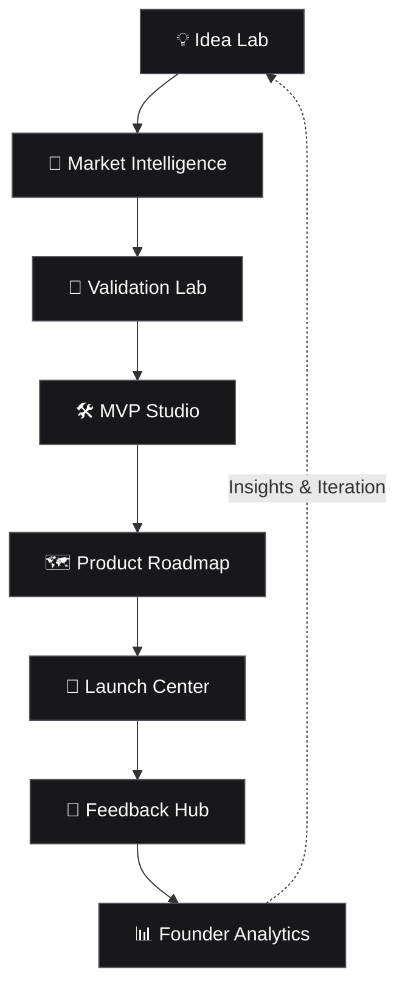
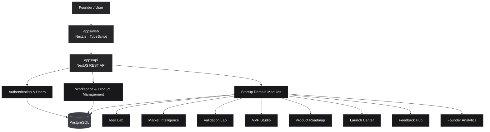

# ⚒️ Foundry
### From Idea to Launch. One Connected Ecosystem.

**Foundry is a Startup Builder Ecosystem designed to help founders turn raw ideas into validated, market-ready products.**

From the first spark of an idea to market research, validation, MVP development, product planning, launch, and analytics — Foundry brings the essential stages of building a startup into one connected workflow.

Instead of juggling disconnected tools, scattered documents, and fragmented workflows, founders can move through the entire startup lifecycle within a unified environment.

> **One idea. Eight stages. One ecosystem.**

---

## ✦ The Vision

Building a startup shouldn't mean stitching together dozens of disconnected tools.

Foundry is built around a simple principle: **every stage of building a startup should inform the next.**

Market research should influence validation. Validation should shape the MVP. The MVP should guide the roadmap. Launch feedback should drive product improvements. Analytics should help founders make better decisions.

Foundry connects these stages into a continuous product-building cycle.



The result is more than a collection of features. It's a connected system for making informed decisions at every stage of a startup's journey.

---

## 🚀 The Eight Core Modules

### 01. 💡 Idea Lab
**Where ideas take shape.**

Transform early-stage concepts into structured product opportunities.

- Capture and organize startup ideas.
- Define the problem, target audience, and proposed solution.
- Document assumptions and core value propositions.
- Compare and prioritize competing ideas.
- Turn unstructured thoughts into actionable concepts.

### 02. 🔎 Market Intelligence
**Understand the market before entering it.**

Give founders a structured way to investigate the environment in which their products will compete.

- Define target markets and customer segments.
- Research competitors and alternative solutions.
- Identify market opportunities and potential threats.
- Document customer pain points and market assumptions.
- Organize research into actionable insights.

### 03. 🧪 Validation Lab
**Test assumptions before investing heavily.**

Help founders evaluate whether an idea addresses a real problem and deserves further investment.

- Define hypotheses and validation criteria.
- Design experiments and customer interviews.
- Collect and organize validation evidence.
- Track assumptions, findings, and outcomes.
- Make evidence-informed go, pivot, or stop decisions.

### 04. 🛠️ MVP Studio
**Turn validated ideas into tangible products.**

Create a focused path from a validated concept to a minimum viable product.

- Define the MVP scope and essential features.
- Separate must-have functionality from future improvements.
- Connect product requirements to validated problems.
- Organize development priorities.
- Keep the initial product focused on delivering core value.

### 05. 🗺️ Product Roadmap
**Give the product a clear direction.**

Translate product goals into an evolving, prioritized execution plan.

- Define milestones and product objectives.
- Prioritize features and improvements.
- Organize work into development phases.
- Track planned versus completed work.
- Adapt the roadmap as new evidence emerges.

### 06. 🚀 Launch Center
**Prepare the product to meet the world.**

Coordinate the activities required to introduce a product to its target audience.

- Define launch objectives and target audiences.
- Organize launch tasks and milestones.
- Plan positioning and messaging.
- Coordinate launch activities.
- Track launch progress and post-launch actions.

### 07. 💬 Feedback Hub
**Turn real user experiences into product improvements.**

Create a structured connection between customers and the product development process.

- Collect and organize user feedback.
- Identify recurring problems and feature requests.
- Categorize feedback by topic and priority.
- Connect feedback to product decisions.
- Feed real-world insights back into the roadmap.

### 08. 📊 Founder Analytics
**Make decisions with evidence, not guesswork.**

Bring important product and startup signals together to support better decisions.

- Monitor relevant product and startup metrics.
- Track progress against defined objectives.
- Analyze feedback and performance trends.
- Identify areas requiring attention.
- Use insights to guide the next iteration.

---

## 🏗️ Architecture

Foundry is organized as a monorepo with a Next.js frontend and a NestJS backend API. The backend follows a modular-monolith approach, keeping domain boundaries explicit while allowing the application to operate as a cohesive system.



### Architectural principles

- **Domain-driven modularity:** Each business domain has a clear responsibility and boundary.
- **Separation of concerns:** The frontend, API, domain logic, and persistence layer remain distinct.
- **Shared infrastructure:** Authentication, users, workspaces, notifications, and file handling support multiple product modules.
- **End-to-end consistency:** Domain relationships connect research, validation, execution, launch, and feedback.
- **Maintainability:** A modular monolith keeps development and deployment straightforward without sacrificing internal structure.
- **Testability:** Domain logic and API behavior should be independently testable.

---

## 🧰 Technology Stack

| Layer | Technology |
|---|---|
| Frontend | Next.js |
| Language | TypeScript |
| Backend | NestJS |
| API | REST |
| Database | PostgreSQL |
| ORM | Prisma |
| Monorepo | pnpm Workspaces |
| Build orchestration | Turborepo |
| API documentation | Swagger / OpenAPI |
| Testing | Jest, integration tests |

The stack is designed to support a maintainable full-stack application with clear boundaries between presentation, business logic, and data access.

---

## 📁 Repository Structure

```text
foundry/
├── apps/
│   ├── web/                 # Next.js frontend
│   └── api/                 # NestJS backend
├── package.json             # Root scripts and dependencies
├── pnpm-workspace.yaml      # Workspace configuration
├── pnpm-lock.yaml           # Dependency lockfile
├── turbo.json               # Turborepo configuration
└── README.md
```

The monorepo keeps the frontend and backend in one repository while allowing each application to maintain its own responsibilities, dependencies, and development workflow.

*The structure above represents the repository's intended high-level layout; individual files and internal module structures may evolve as development progresses.*

---

## 🔐 Backend Domain Organization

Beyond the eight product-facing modules, Foundry requires a shared foundation that supports the entire ecosystem.

| Domain | Responsibility |
|---|---|
| Auth | Authentication, sessions, and access control |
| Users | User profiles and account management |
| Workspaces | Startup workspaces and collaboration boundaries |
| Products | Product identity and cross-module relationships |
| Idea Lab | Idea capture and organization |
| Market Intelligence | Market and competitor research |
| Validation Lab | Hypotheses, experiments, and findings |
| MVP Studio | MVP scope and feature definition |
| Product Roadmap | Milestones and prioritization |
| Launch Center | Launch planning and execution |
| Feedback Hub | User feedback and product insights |
| Founder Analytics | Metrics and decision support |
| Notifications | System and activity notifications |
| Files | File and asset management |
| Common | Shared utilities, guards, decorators, and infrastructure |

These domains should evolve around clear responsibilities rather than becoming a collection of unrelated CRUD endpoints.

---

## 🔄 The Foundry Workflow

Foundry's modules are most valuable when they work together.

1. **Capture** — Record an idea and define the problem it addresses.
2. **Investigate** — Research the market, audience, and competition.
3. **Validate** — Test assumptions and collect evidence.
4. **Build** — Define and develop a focused MVP.
5. **Plan** — Establish priorities, milestones, and the product roadmap.
6. **Launch** — Coordinate the product's market introduction.
7. **Listen** — Collect user feedback and identify recurring needs.
8. **Learn** — Analyze outcomes and feed insights into the next iteration.

This workflow is iterative, not strictly linear. A failed experiment may send a founder back to the Idea Lab. New feedback may change the roadmap. Analytics may reveal that a product needs a different audience or value proposition.

**Foundry treats iteration as a fundamental part of building a startup.**

---

## 🛠️ Getting Started

### Prerequisites

- Node.js
- pnpm
- PostgreSQL
- Git

### Installation

Clone the repository:

```bash
git clone <repository-url>
cd Foundry
```

Install dependencies:

```bash
pnpm install
```

Configure the required environment variables for the frontend and backend according to their respective environment examples.

Set up the PostgreSQL database and configure the Prisma connection string.

Run the database migrations and generate the Prisma client using the scripts configured in the API workspace.

Start the applications using the development scripts defined in the root `package.json`.

> **Note:** Exact environment variable names, migration commands, and development scripts depend on the current repository configuration. Refer to the application-level instructions before running database or deployment commands.

---

## 🧪 Engineering Principles

Foundry is built around engineering practices that support long-term product development:

- **Modular design** — Keep business domains independent and understandable.
- **Explicit ownership** — Give each module responsibility for its own business rules.
- **Consistent API contracts** — Document endpoints and make integrations predictable.
- **Secure by design** — Apply authentication, authorization, validation, and safe data handling.
- **Reliable persistence** — Maintain data integrity across related startup workflows.
- **Automated testing** — Verify important domain rules and API behavior.
- **Incremental delivery** — Build the ecosystem in manageable, testable stages.
- **Meaningful integration** — Ensure modules exchange useful domain information instead of duplicating responsibilities.

---

## 🗺️ Product Roadmap

The long-term product direction follows the evolution of a startup.

- [ ] Establish the core platform: authentication, users, and workspaces.
- [ ] Build the foundational product and idea-management workflows.
- [ ] Introduce market research and validation capabilities.
- [ ] Connect validated concepts to MVP planning and roadmaps.
- [ ] Develop launch planning and feedback collection.
- [ ] Integrate product and founder analytics.
- [ ] Strengthen cross-module workflows and automated testing.
- [ ] Improve collaboration, observability, and production readiness.

*This roadmap describes the product direction, not a verified checklist of completed features.*

---

## 🎯 Who Is Foundry For?

- **Aspiring founders** turning early ideas into structured opportunities.
- **Indie hackers** looking for a more organized product-building workflow.
- **Startup teams** coordinating research, validation, and execution.
- **Product builders** who want decisions grounded in customer evidence.
- **Entrepreneurs** managing the journey from concept to launch and beyond.

---

## 💡 The Philosophy

Most tools solve one problem exceptionally well. Foundry aims to solve a different problem: **the fragmentation between the many problems a founder must solve.**

A startup isn't just an idea, a roadmap, or a launch campaign. It's a sequence of interconnected decisions made under uncertainty.

Foundry brings those decisions into one ecosystem, helping founders preserve context, learn faster, and build with greater clarity.

The goal isn't to replace thinking with software.

It's to give founders a better system for thinking, building, and learning.

---

## 📄 License

Add the project's chosen license here before distributing Foundry publicly.

---

<p align="center">
  <strong>Foundry — Build with clarity. Validate with evidence. Launch with purpose.</strong>
</p>
